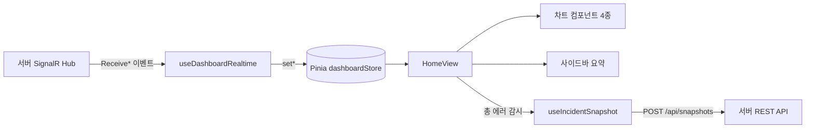

# 2026-Dashboard-Client

**실시간 서비스 현황 대시보드의 프론트엔드**입니다.
SignalR로 서버가 보내는 가동률, 국가별 에러, 알림 추이를 차트로 보여주고, 장애 상황을 화면 그대로 **스냅샷 이미지로 캡처해 서버에 저장**합니다.

짝이 되는 백엔드는 [2026-Dashboard-Server](https://github.com/sangyeon08/2026-Dashboard-Server)입니다.

---

## 목차
1. [주요 기능](#주요-기능)
2. [기술 스택](#기술-스택)
3. [화면 구성](#화면-구성)
4. [서버 연동](#서버-연동)
5. [장애 스냅샷 캡처](#장애-스냅샷-캡처)
6. [상태 관리와 데이터 흐름](#상태-관리와-데이터-흐름)
7. [프로젝트 구조](#프로젝트-구조)
8. [CI](#ci)

---

## 주요 기능

| 기능 | 설명 |
| --- | --- |
| 실시간 대시보드 | SignalR로 수신한 데이터를 새로고침 없이 차트와 사이드바에 즉시 반영 |
| 차트 4종 | 글로벌 가동률(도넛), 국가별 에러(막대), 알림 총계(꺾은선), 시간대별 알림(누적 막대) |
| 사이드바 요약 | 전체 가동률, 총 에러 발생량, 최대 에러 발생 국가, 활성 경보 수 |
| 장애 스냅샷 | 수동 버튼 또는 에러 임계값 초과 시 자동으로 화면을 캡처해 업로드 |
| 스냅샷 갤러리 | 저장된 스냅샷을 썸네일로 보고, 캡처 시각 · 방식 · 에러 수치를 툴팁으로 확인 |
| 로그 조회 | 오늘 기록된 로그 목록 확인 |

## 기술 스택

| 구분 | 사용 기술 |
| --- | --- |
| 프레임워크 | Vue 3 (Composition API, `<script setup>`) |
| 빌드 | Vite |
| 라우팅 | Vue Router |
| 상태 관리 | Pinia |
| 서버 상태 / 캐시 | TanStack Query (Vue Query) |
| 실시간 통신 | `@microsoft/signalr` |
| 화면 캡처 | html2canvas |
| 스타일 | SCSS, CSS 변수 (`base.css`) |
| 차트 / 아이콘 / 버튼 | SVG와 HTML/CSS로 직접 구현 |

## 화면 구성

| 경로 | 화면 | 설명 |
| --- | --- | --- |
| `/` | 메인 | 대시보드 / 장애 스냅샷으로 이동하는 시작 화면 |
| `/dashboard` | 대시보드 | 차트 4개와 사이드바 실시간 현황, 캡처 버튼 |
| `/snapshots` | 장애 스냅샷 | 저장된 스냅샷 썸네일 갤러리 |
| `/logs` | 로그 | 오늘 기록된 로그 |

대시보드 레이아웃은 상단 헤더, 좌측 사이드바(메뉴 + 실시간 현황), 우측 본문으로 구성됩니다.

## 서버 연동

### REST API

| 메서드 | 경로 | 용도 |
| --- | --- | --- |
| `GET` | `/api/logs` | 오늘 날짜의 로그 목록 조회 |
| `GET` | `/api/snapshots` | 저장된 스냅샷 목록 조회 |
| `POST` | `/api/snapshots` | 스냅샷 이미지 업로드 (`multipart/form-data`: `file`, `trigger`, `errorCount`) |

### SignalR (`/hubs/dashboard`)

| 구분 | 이름 | 설명 |
| --- | --- | --- |
| 호출 | `JoinDashboardGroup` | 접속 시 그룹에 참여하고 최초 스냅샷을 받음 |
| 호출 | `LeaveDashboardGroup` | 화면을 벗어날 때 그룹에서 나감 |
| 수신 | `ReceiveDashboardSnapshot` | 최초 접속 시 전체 데이터 한 번에 수신 |
| 수신 | `ReceiveGlobalStatus` | 가동률과 정상 / 경고 / 장애 수 갱신 |
| 수신 | `ReceiveRegionStats` | 국가별 에러 수와 허용 기준치 갱신 |
| 수신 | `ReceiveAlertTrend` | 시간대별 알림 추이 갱신 |

연결은 자동 재연결을 켠 싱글턴 하나만 사용합니다.

### 개발 서버 프록시
개발 중에는 Vite가 `/api`와 `/hubs`(WebSocket 포함) 요청을 `http://localhost:5112`의 백엔드로 전달합니다.
덕분에 프론트와 백엔드의 포트가 달라도 CORS 설정 없이 상대 경로로 호출합니다.

## 장애 스냅샷 캡처

`useIncidentSnapshot`이 담당합니다.

1. 대시보드 본문 영역(`app-main`)을 `html2canvas`로 캡처
2. 캡처 결과를 PNG `Blob` → `File`로 변환
3. `POST /api/snapshots`로 업로드 (`trigger`: `manual` 또는 `auto`)

| 방식 | 조건 |
| --- | --- |
| 수동 | 사이드바의 **장애 스냅샷 찍기** 버튼 |
| 자동 | 총 에러 발생량이 임계값(125건) 이상 |

자동 캡처는 연속 촬영을 막기 위해 **30초 쿨다운**이 있습니다. 차트만이 아니라 사이드바 수치까지 함께 남도록 `app-main` 전체를 캡처 대상으로 삼았습니다.

## 상태 관리와 데이터 흐름



- **Pinia**: SignalR로 들어오는 실시간 데이터의 보관소. 컴포넌트는 연결 자체를 몰라도 됩니다.
- **Vue Query**: 로그 / 스냅샷 같은 REST 조회와 업로드(mutation)를 담당합니다.
- **`useDashboardRealtime`**: 연결, 그룹 참여, 이벤트 등록과 해제를 감싼 컴포저블입니다.

## 프로젝트 구조

```
src/
├── main.js                         앱 진입점 (Pinia · Router · Vue Query 등록)
├── App.vue
├── router/                         라우트 정의
├── stores/
│   └── dashboardStore.js           실시간 데이터와 연결 상태
├── core/
│   ├── api/
│   │   ├── dashboard/              SignalR 이벤트 구독 컴포저블
│   │   ├── logs/                   로그 조회 쿼리
│   │   └── snapshots/              스냅샷 조회 쿼리 · 업로드 mutation
│   ├── capture/                    화면 캡처와 자동 캡처 로직
│   └── signalr/                    SignalR 연결 싱글턴
├── layouts/
│   └── DashboardLayout.vue         헤더 + 사이드바 + 본문 레이아웃
├── views/                          MainView · HomeView · SnapshotsView · LogsView
├── components/
│   ├── charts/                     도넛 · 막대 · 꺾은선 · 누적 막대 차트 (SVG)
│   ├── sidebar/                    사이드바 요약 항목
│   └── common/                     AppIcon · AppButton
└── assets/styles/                  CSS 변수(base.css), SCSS 변수
```

## CI

`.github/workflows/ci.yml`이 `main` / `develop`에 push 하거나 PR을 올릴 때 의존성 설치(`npm ci`)와 빌드(`npm run build`)를 자동으로 확인합니다.
